# home-soc-lab
Home cybersecurity lab built with VMware, Kali Linux, Wazuh SIEM, Metasploitable 2, Ubuntu Server, and FLARE VM for penetration testing, security monitoring, and malware analysis.

# Home Cybersecurity Lab with Wazuh SIEM

## Overview

In this project, I built a home cybersecurity lab using VMware Workstation Pro to gain hands-on experience with security monitoring, endpoint management, vulnerability assessment, and malware analysis.

The lab consists of multiple virtual machines including Kali Linux, Metasploitable2, Ubuntu Server, Ubuntu Desktop Client, Windows 10, and FlareVM. A Wazuh SIEM server was deployed to centralize monitoring and collect security events from monitored systems.

The goal of this project was to better understand how security teams monitor devices, collect logs, detect threats, and manage endpoints within a controlled environment.

---

## Lab Environment

### Virtual Machines

| Machine | Purpose |
|----------|----------|
| Kali Linux | Penetration Testing |
| Metasploitable2 | Vulnerable Target |
| Ubuntu Server | Wazuh Manager |
| Ubuntu Client | Wazuh Agent |
| Windows 10 | Malware Analysis Host |
| FlareVM | Malware Analysis Tools |

---

## Skills Demonstrated

- Virtualization with VMware Workstation Pro
- Linux Administration
- Windows Administration
- SIEM Deployment
- Endpoint Monitoring
- Vulnerability Assessment
- Network Configuration
- SSH Configuration
- Malware Analysis Environment Setup
- Security Monitoring

---

# Project Walkthrough

## Step 1 - Installing VMware Workstation Pro

I started by installing VMware Workstation Pro which would host the entire cybersecurity lab environment.

After installation, I configured a NAT network and DHCP services to allow communication between all virtual machines while maintaining internet connectivity.

### Screenshot

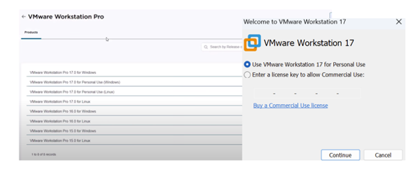

### Screenshot

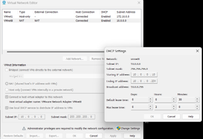

---

## Step 2 - Deploying Kali Linux

I imported Kali Linux into VMware and verified that networking was functioning correctly.

After booting the machine, I confirmed it had received an IP address and tested internet connectivity using ping commands.

### Screenshot

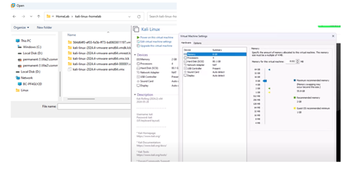

### Screenshot

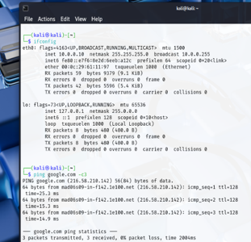

---

## Step 3 - Deploying Metasploitable2

To simulate a vulnerable target machine, I deployed Metasploitable2.

The system was connected to the same NAT network and tested for communication with Kali Linux.

### Screenshot

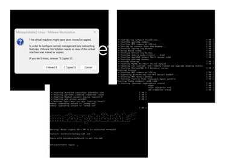

### Screenshot

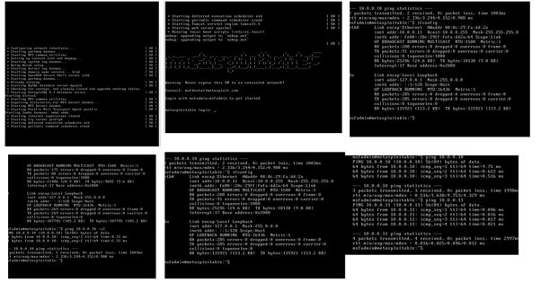

---

## Step 4 - Installing Ubuntu Server

An Ubuntu Server virtual machine was created to host the Wazuh SIEM platform.

During installation I configured networking, enabled OpenSSH, and updated all packages after deployment.

### Screenshot

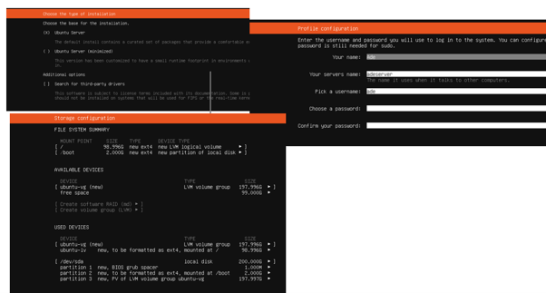

### Screenshot

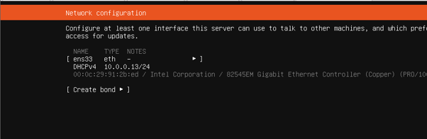

---

## Step 5 - Deploying Wazuh SIEM

The next stage was deploying Wazuh on the Ubuntu Server.

Using the official installation script, I installed the Wazuh Manager and Dashboard and configured administrator access.

### Screenshot

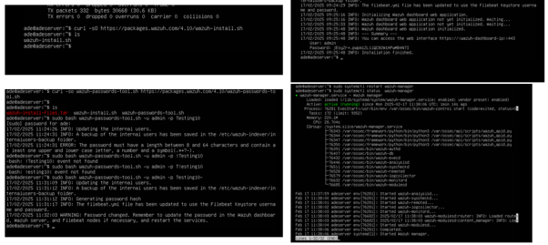

### Screenshot

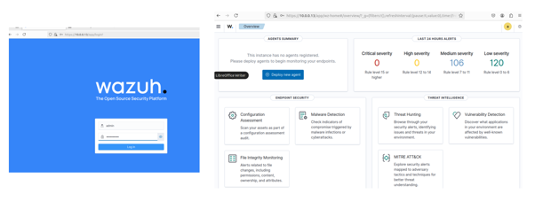

---

## Step 6 - Adding an Endpoint Agent

To begin monitoring endpoints, I installed the Wazuh Agent on an Ubuntu client machine.

After registering the agent with the manager, I confirmed successful communication through the Wazuh dashboard.

### Screenshot

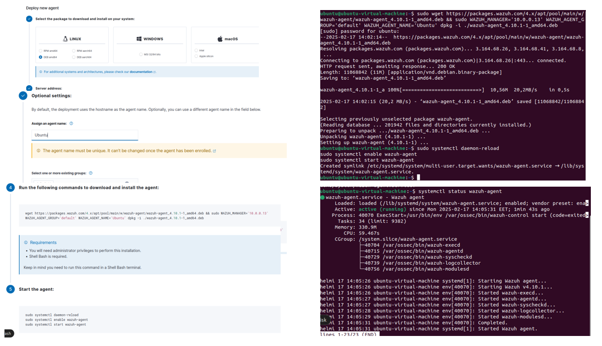

### Screenshot

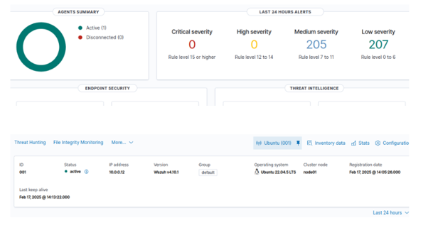

---

## Step 7 - Preparing Windows 10 for FlareVM Installation

Before installing FlareVM, I configured the Windows 10 virtual machine to avoid interruptions during the installation process.

### Disable Real-Time Protection

Windows Defender Real-Time Protection was temporarily disabled to prevent security controls from interfering with FlareVM installation scripts and security tools.

#### Actions Performed

1. Opened Windows Security.
2. Selected Virus & Threat Protection.
3. Opened Manage Settings.
4. Disabled Real-Time Protection.

### Screenshot

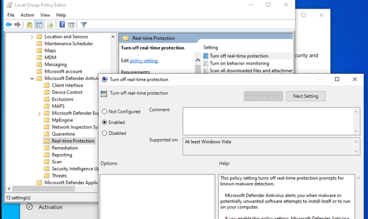

---

### Disable Microsoft Defender Antivirus

To ensure successful installation of all FlareVM components, Microsoft Defender Antivirus was disabled through Group Policy configuration.

#### Actions Performed

1. Opened Local Group Policy Editor.
2. Navigated to:

```text
Computer Configuration
 └─ Administrative Templates
    └─ Windows Components
       └─ Microsoft Defender Antivirus
```

3. Opened "Turn off Microsoft Defender Antivirus".
4. Changed setting to Enabled.
5. Restarted the virtual machine.

### Screenshot

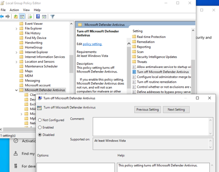

---

### Disable Automatic Windows Updates

Automatic Windows Updates were disabled to prevent system changes from interfering with malware analysis tooling.

#### Actions Performed

1. Opened Services.
2. Located Windows Update.
3. Stopped the service.
4. Changed Startup Type to Disabled.

### Screenshot

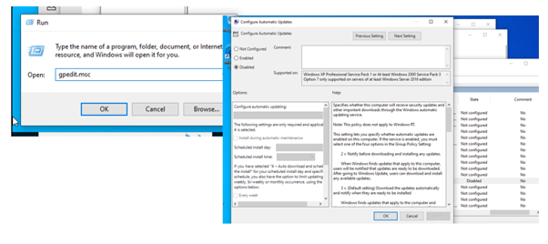

---

### Configure System Resources

To ensure stable performance, virtual machine resources were reviewed and adjusted.

#### Actions Performed

- Increased RAM allocation.
- Verified available disk space.
- Checked CPU assignment.
- Tested overall system responsiveness.


------
## Step 8 - Installing FlareVM

After preparing the Windows 10 environment, I installed FlareVM to create a dedicated malware analysis workstation.

FlareVM installs a collection of security and malware analysis tools used by threat researchers, malware analysts, and incident responders.

The installation process required administrative privileges and additional configuration to allow all packages to install successfully.

### Skills Gained

- Malware Analysis Environment Setup
- Windows Security Configuration
- Virtual Machine Hardening and Preparation
- Security Tool Deployment
- Incident Response Tool Familiarization


------

## Step  - Deploying Windows 10 and FlareVM

To create a malware analysis environment, I deployed a Windows 10 virtual machine and installed FlareVM.

This system provides a dedicated workspace for malware analysis activities.

### Screenshot

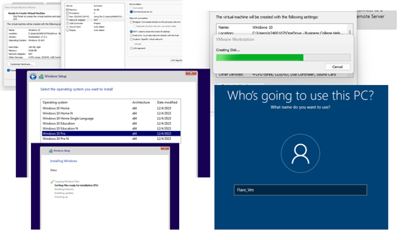

### Screenshot

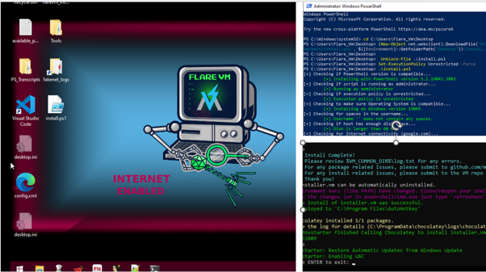

---

# Challenges Encountered

## Networking Issues

One of the main challenges was ensuring each virtual machine received the correct IP address and could communicate across the VMware NAT network.

This was resolved by verifying DHCP settings, subnet configuration, and testing connectivity with ping commands.

## Resource Management

Running multiple virtual machines simultaneously required careful allocation of RAM and CPU resources. Adjustments were made to maintain stable performance across the lab environment.

---

# Key Learning Outcomes

Through this project I gained practical experience in:

- Building virtual cybersecurity laboratories
- Configuring virtual networking
- Linux server administration
- SIEM deployment and management
- Endpoint monitoring
- Wazuh agent deployment
- Threat monitoring
- Security event analysis
- Malware analysis environment setup
- Troubleshooting enterprise-style environments

---

# Future Improvements

Future enhancements for this lab include:

- Deploying Sysmon
- Creating custom Wazuh detection rules
- Simulating attacks from Kali Linux
- MITRE ATT&CK Mapping
- Log Analysis Use Cases
- Incident Response Scenarios
- Threat Hunting Dashboards

---


